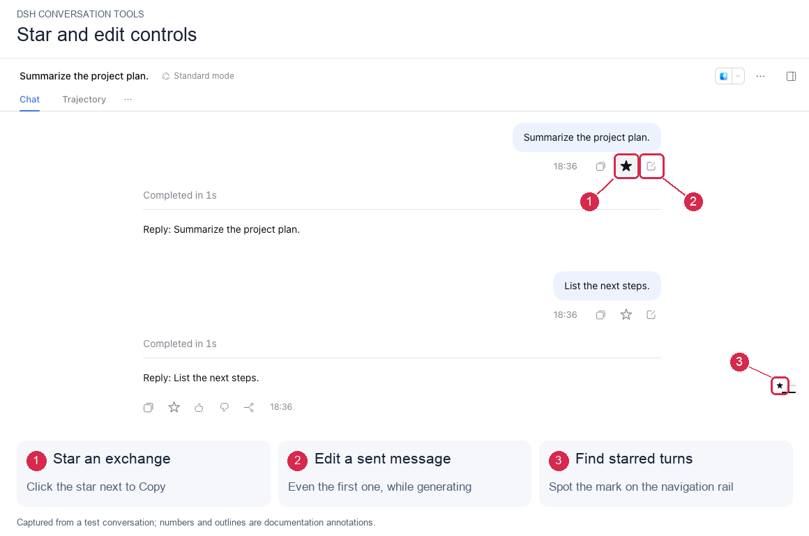
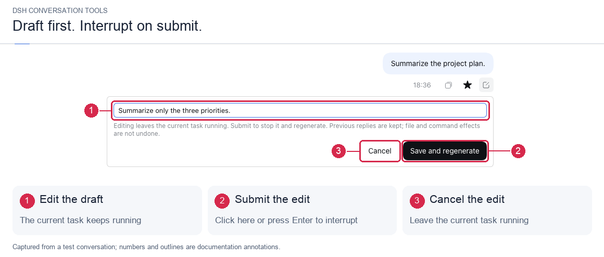
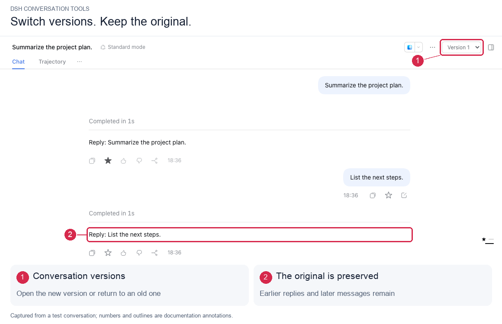

# DSH Conversation Tools

**Star important exchanges. Restart from any message.**

[中文](README.md) · English

[](https://github.com/Hai-Story/dsh-conversation-tools/releases) [](https://github.com/Hai-Story/dsh-conversation-tools/actions/workflows/ci.yml) [](LICENSE)

`dsh-conversation-tools` adds **Star** and **Edit** beside Copy in DeepSeek Harness. Mark exchanges you want to revisit, or edit a sent message and regenerate from there while keeping the original conversation as a previous version.



[Install and update](#install-and-update) · [Star an exchange](#star-an-exchange) · [Edit a message](#edit-a-message) · [Previous versions](#previous-versions) · [Compatibility](#compatibility)

## Install and update

Tested host: **DSH `0.2.2-rc.1` Web**. This is an independent plugin; no Harness source changes or rebuild are required.

Paste this source into DSH's **Add plugin** dialog:

```text
github:Hai-Story/dsh-conversation-tools#v0.1.1
```

Or install into the Web profile from the command line:

```sh
dsh plugin --profile web add "github:Hai-Story/dsh-conversation-tools#v0.1.1"
```

Use the same source or command to update an older installation, then restart DSH. Release versions include `dist/`, so installation requires no build scripts.

<details>
<summary>Installing in the official desktop app</summary>

Use the app's plugin UI, or its bundled `dsh` command with the `desktop` profile. Web and desktop profiles are separate; installing into `web` does not enable the plugin in desktop.

Browser flows have been verified against the stock npm Web distribution. Electron installation has not been independently tested.

</details>

## Star an exchange

Click `☆` beside Copy to mark an **entire question-and-answer exchange** with `★`. The human and assistant controls share the same state, and the turn rail and its hover preview show the mark. Click again to remove it. Stars survive reloads and restarts.

The action is called **Star** throughout the plugin: it marks an important exchange so you can find it again in a long conversation.

## Edit a message

Edit any sent human message, **including the first**. Click Edit, change the text inline, then press Enter or choose **Save and regenerate**.



**You can edit during generation. The current task is interrupted only when you submit.**

| Action | What happens to the current task |
| --- | --- |
| Open the editor or change the draft | Keeps running |
| Shift+Enter or IME confirmation | Keeps running; nothing is submitted |
| Cancel the edit | Keeps running; the draft is discarded |
| Enter or Save and regenerate | Cancellation is requested; the edited message is submitted after the old task settles |

Regeneration uses the earlier context and the edited message. Existing attachments remain; the replaced answer and later messages are excluded from the new context. The current working directory and model selection are preserved.

## Previous versions

Submitting an edit opens the new version. Use the version selector at the top of the conversation to return to an old version and read its original answers and later messages.



Versions are stored as separate Sessions in the same workspace and may also appear in the ordinary conversation list. Switching versions does not merge subsequent work.

> Editing changes conversation context. It **does not undo file changes, commands, or other tool effects**.

*Screenshots were captured from a running test conversation. Red outlines, numbers, and captions identify feature locations.*

## Compatibility

| Environment | Verification |
| --- | --- |
| Stock DSH `0.2.2-rc.1` Web | Installation and browser flows tested |
| Official Electron desktop | Installation not independently tested |
| Other DSH versions | No compatibility claim yet |

Editing changes text only; attachments cannot be added or removed. Other browser clients reconcile stars on reload or reconnect. The host's turn rail stays hidden for single-turn conversations. English and Simplified Chinese UI copy are included.

## Development and contributions

Report problems or suggest improvements in [Issues](https://github.com/Hai-Story/dsh-conversation-tools/issues) or a pull request. For UI issues, include the DSH version and reproduction steps.

<details>
<summary>Local development and validation</summary>

Requires Node.js 24.9+ and pnpm 11.28.5:

```sh
corepack enable
pnpm install --frozen-lockfile --ignore-scripts
pnpm run check
pnpm run verify:dist
pnpm exec playwright install chromium
pnpm run test:browser
```

The browser test installs the packed plugin into an isolated profile and starts stock npm DSH, substituting only the external model with a keyless fixture. It covers stars, first-message editing, future-context exclusion, version switching, reload, drafting during generation, button/Enter submission, IME confirmation, cancellation, and duplicate submissions. Temporary profiles and logs stay in Git-ignored `.artifacts/`.

Remote interface changes require updating types and descriptors in `src/protocol/` together and exercising end-to-end calls. Rebuild and commit `dist/` before release; CI checks that artifacts match the source.

Original screenshots and element coordinates are retained in `docs/images/readme/raw/`. See [screenshot notes](docs/screenshots.md) to regenerate the annotations.

</details>

<details>
<summary>How does the plugin integrate with Harness?</summary>

The package exposes a Cordis bundle and generated Remote descriptors. Assistant actions and the version selector use existing slots. A session-scoped DOM adapter mounts user-message controls and rail markers while keeping the original message renderers.

The adapter addresses `data-conversation-session`, `data-chat-node-key`, `data-clock`, and rail `data-index`. Message identities come from Chat data, never DOM text. Disposal removes only plugin-owned mounts and styles, without changing host files. This depends on the tested host's UI structure and must be revalidated for host upgrades.

Version creation reuses `session/fork` and `session/create`. Stars and version relationships use the `conversation_tools` storage domain; original logs are never overwritten.

</details>

## References and license

The README's feature presentation, installation entry points, and screenshot organization were informed by [dsh-context](https://github.com/bowenliang123/dsh-context), [dsh-pocket](https://github.com/shaobeichen/dsh-pocket), and [DSH-better-sidebar](https://github.com/omdsh-dev/DSH-better-sidebar). Packaging conventions were informed by [dsh-nested-followups](https://github.com/sluminositys/dsh-nested-followups). Host interfaces come from [DeepSeek Harness](https://github.com/deepseek-ai/deepseek-harness).

[MIT License](LICENSE) · [Third-party notices](THIRD_PARTY_NOTICES.md)
