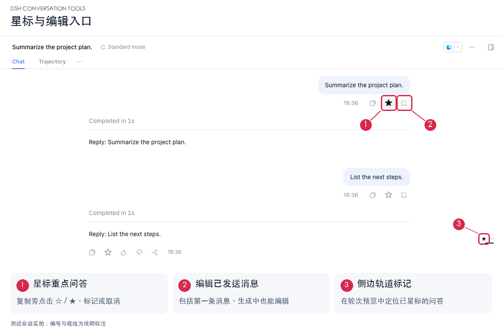
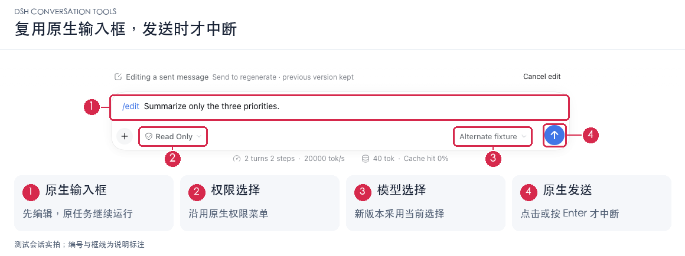
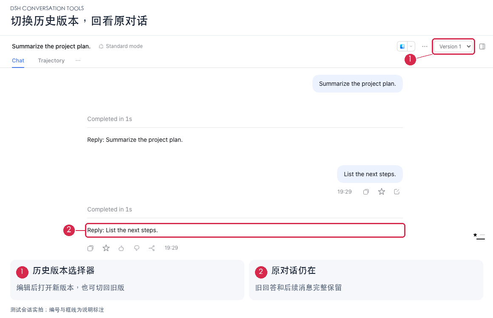

# DSH Conversation Tools

**星标重点问答，从任意一条消息重新开始。**

中文 · [English](README.en.md)

[](https://github.com/Hai-Story/dsh-conversation-tools/releases) [](https://github.com/Hai-Story/dsh-conversation-tools/actions/workflows/ci.yml) [](LICENSE)

`dsh-conversation-tools` 为 DeepSeek Harness 的复制按钮旁增加 **星标** 和 **编辑** 两个操作。重要问答可以标记后回看；已发送消息可以修改后重新生成，原对话保留为历史版本。



[安装与更新](#安装与更新) · [星标问答](#星标问答) · [编辑消息](#编辑消息) · [历史版本](#历史版本) · [兼容性](#兼容性) · [本地恢复与隐私](#本地恢复与隐私)

## 安装与更新

已验证宿主版本：**DSH `0.2.2-rc.1` Web**。这是独立插件，无需修改或重新编译 Harness。

在 DSH 的「添加插件」中粘贴：

```text
github:Hai-Story/dsh-conversation-tools#v0.1.3
```

或使用命令行安装到 Web 配置：

```sh
dsh plugin --profile web add "github:Hai-Story/dsh-conversation-tools#v0.1.3"
```

更新旧版本也使用上述地址或命令，完成后重启 DSH。仓库随版本提供 `dist/`，安装时不需要执行构建脚本。

<details>
<summary>官方桌面端如何安装？</summary>

使用应用内的插件界面，或桌面端自带的 `dsh` 命令操作 `desktop` 配置。Web 和桌面端的配置独立，安装在 `web` 中不会自动启用到桌面端。

浏览器流程已在原版 npm Web 发行包上验证；Electron 桌面安装尚未单独验证。

</details>

## 星标问答

遇到值得回看的回答，点击复制旁的 `☆`，即可为**整轮问答**加上 `★`。提问和回答下方的星标同步，侧边轮次轨道及悬停预览也会显示标记。再次点击即可取消，刷新或重启后标记仍在。

这里统一使用 **星标（Star）**：用星形图标标记重点问答，方便在长对话中定位。

## 编辑消息

支持修改任意已发送的用户消息，**包括第一条消息**。点击编辑图标，消息会进入底部原生输入框；可照常选择权限和模型，再按 Enter 或点击原生发送箭头。取消编辑会恢复此前未发送的草稿。



**生成过程中也能编辑；只有提交时才中断原任务。**

| 操作 | 原任务如何处理 |
| --- | --- |
| 打开编辑框、修改草稿 | 继续运行 |
| Shift+Enter 换行、输入法确认 | 继续运行，不提交 |
| 取消编辑 | 继续运行，恢复进入编辑前的草稿 |
| Enter 或原生发送按钮 | 请求中断，等待原任务结束后发送修改后的消息 |

重新生成使用修改点之前的上下文和新消息。原附件保留，修改点之后的旧回答及后续消息不进入新上下文；工作目录保持不变，新的版本采用原生菜单中当前选定的权限和模型。

编辑部分完成时，失败提示会保留草稿和已创建的会话。刷新后可点击“恢复编辑草稿”，保持编辑内容不变再次发送；取消会恢复原来的未发送草稿。如果你在恢复前已输入新的草稿或添加附件，会保留这些新内容。

## 历史版本

提交编辑后自动打开新版本。通过对话顶部的版本选择器，可以切回旧版本，查看原来的回答和后续对话。



版本作为同一工作区内的独立会话保存，也可能出现在普通会话列表中。切换版本不会合并两边的后续工作。

> 编辑改变聊天上下文，**不会撤销已经执行的文件修改、命令或其他工具操作**。

*截图来自实际运行的测试会话；红框、编号和图注用于说明功能位置。*

## 兼容性

| 环境 | 验证情况 |
| --- | --- |
| 原版 DSH `0.2.2-rc.1` Web | 已通过安装与浏览器流程测试 |
| 官方 Electron 桌面端 | 安装尚未单独验证 |
| 其他 DSH 版本 | 暂不声明兼容 |

**升级策略：** 插件目前精确支持 `0.2.2-rc.1`。升级 DSH 前先检查本页的支持版本；新版本可能被宿主判为不兼容。我们会先核对接口并通过安装、编辑恢复和布局测试，再更新兼容声明并发布插件。验证完成前，请保留已支持的 DSH 版本，或停用插件后升级；不建议绕过宿主的兼容检查。

当前只编辑文本，不增删附件。多个浏览器客户端通过刷新或重连同步星标；仅有一轮问答时，沿用 DSH 隐藏侧边轮次轨道的行为。界面提供中文和英文。

## 本地恢复与隐私

星标和版本关联由 DSH 保存在本地存储域。编辑只完成了一部分时，插件还会把修改文本、进入编辑前的草稿（含文本引用与引文）、会话及请求标识写入当前标签页的 `sessionStorage`，用于刷新后的恢复；普通编辑草稿不会因此持续写入该存储。

恢复记录未加密，同源页面脚本可以访问，不会作为额外遥测上传。提交成功、取消编辑或开始另一条编辑时会清除记录；关闭标签页后不保证保留。浏览器禁止存储或空间不足时，当前页面仍保留内存草稿，但刷新恢复可能不可用。

## 开发与贡献

发现问题或有改进建议，欢迎提交 [Issue](https://github.com/Hai-Story/dsh-conversation-tools/issues) 或 Pull Request。报告界面问题时，请附上 DSH 版本及复现步骤。

<details>
<summary>本地开发与验证</summary>

需要 Node.js 24.9+ 和 pnpm 11.28.5：

```sh
corepack enable
pnpm install --frozen-lockfile --ignore-scripts
pnpm run check
pnpm run verify:dist
pnpm exec playwright install chromium
pnpm run test:browser
```

浏览器测试在独立临时配置中安装打包后的插件，运行原版 npm DSH，只用测试模型替代外部模型请求，不使用 API Key。测试覆盖星标、首条编辑、旧上下文排除、版本切换、刷新恢复，以及生成中编辑、按钮/Enter 提交、输入法确认、取消和重复提交，以及原生权限/模型选择、空输入框或新草稿下的刷新恢复、Trajectory 切换、右侧面板全屏/分栏/收起。临时配置与日志写入被 Git 忽略的 `.artifacts/`。

发布时同步更新 `package.json` 的版本和两份 README 的安装地址，构建并提交 `dist/`。合并且 CI 通过后，将对应提交标记为 `v<版本号>`，创建 GitHub Release 并上传 `npm pack` 生成的安装包，再验证文档中的真实安装地址：

```sh
DSH_TEST_INSTALL_SPEC=github:Hai-Story/dsh-conversation-tools#v0.1.3 pnpm run test:browser
```

修改 Remote 接口时，同时更新 `src/protocol/` 中的类型与描述并验证端到端调用。发布前重新构建并提交 `dist/`，CI 会检查它与源码是否一致。

截图原图与定位信息保留在 `docs/images/readme/raw/`；重绘标注见[截图说明](docs/screenshots.md)。

</details>

<details>
<summary>插件如何接入 Harness？</summary>

插件通过 Cordis bundle 和生成的 Remote 描述提供宿主服务。助手操作区和顶部版本入口使用已有插槽；用户消息按钮与轨道标记通过限定在当前会话的 DOM 适配器挂载。编辑使用原生输入框的临时 `/edit` 模式，权限、模型、发送键及输入法处理由原组件提供；取消和提交完成后恢复先前草稿。原有消息渲染器不被替换。

适配器定位 `data-conversation-session`、`data-chat-node-key`、`data-clock` 和轨道 `data-index`，消息身份来自 Chat 数据，不从 DOM 文本猜测。禁用插件时移除自己创建的挂载点和样式，不修改宿主文件。适配依赖已验证版本的界面结构，DSH 升级后需要重新验证。

版本创建复用 `session/fork` 和 `session/create`；星标及版本关联保存在 `conversation_tools` 存储域，原会话日志不会被覆盖。

</details>

## 参考与许可

README 的功能展示、安装入口和配图组织参考了 [dsh-context](https://github.com/bowenliang123/dsh-context)、[dsh-pocket](https://github.com/shaobeichen/dsh-pocket) 和 [DSH-better-sidebar](https://github.com/omdsh-dev/DSH-better-sidebar)。插件分发结构参考了 [dsh-nested-followups](https://github.com/sluminositys/dsh-nested-followups)。宿主接口来自 [DeepSeek Harness](https://github.com/deepseek-ai/deepseek-harness)。

[MIT License](LICENSE) · [第三方说明](THIRD_PARTY_NOTICES.md)
