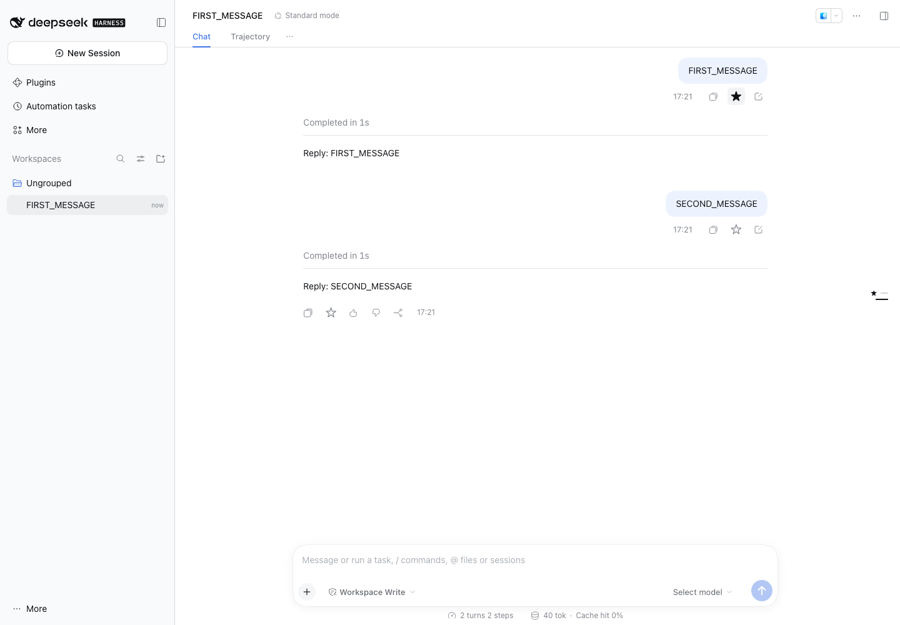
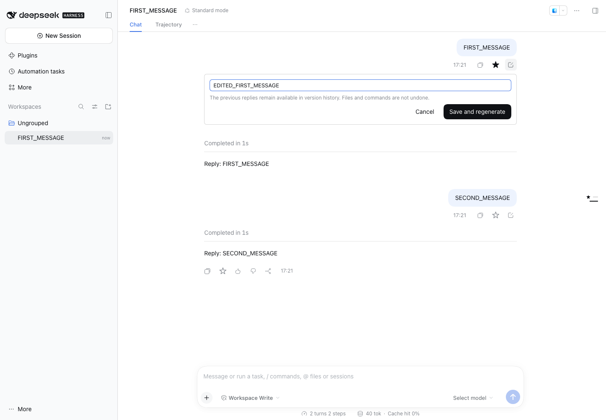

# dsh-conversation-tools

[English](README.en.md) | 中文

为 DeepSeek Harness 增加两个消息操作：**星标问答**、**编辑已发送消息**。编辑后从修改的位置重新生成，旧回答和后续对话完整保留，可切换历史版本。

独立插件，无需修改或重新编译 Harness。不增加分支按钮，也不替换原有消息渲染器。



## 安装

当前验证的宿主版本：**DSH `0.2.2-rc.1`**。插件为早期版本，其他宿主版本暂不声明兼容。

在插件界面的「添加插件」中粘贴：

```text
github:Hai-Story/dsh-conversation-tools#v0.1.0
```

命令行安装到 Web 配置：

```sh
dsh plugin --profile web add "github:Hai-Story/dsh-conversation-tools#v0.1.0"
```

安装后重启 DSH。仓库随版本提交 `dist/`，安装时不需要运行构建脚本。

官方桌面端请使用应用内的插件界面，或桌面端自带的 `dsh` 命令操作 `desktop` 配置；Web 配置中的插件不会自动出现在桌面端。浏览器流程已在原版 npm Web 发行包上验证，Electron 桌面安装尚未单独验证。

## 使用

- **星标**：点击复制旁的 `☆`，同轮提问和回答同步变为 `★`；再次点击取消。侧边轮次轨道和悬停预览也显示星标。标记保存在宿主，刷新后保留。
- **编辑**：点击已发送用户消息旁的编辑图标，包括第一条消息。修改文本后选择「保存并重新生成」。原附件保留，修改点之后的旧对话不进入新上下文。
- **历史版本**：保存后自动打开新版本。通过顶部版本选择器返回旧版本，原回答和后续对话仍在。



生成进行中需要先停止再编辑。编辑仅改变聊天上下文，**不会撤销已经执行的文件修改、命令或其他工具操作**。

## 实现与兼容性

通过 Cordis bundle 和生成的 Remote 描述提供宿主服务；助手操作区及顶部版本入口使用已有插槽。原版 DSH 没有用户消息操作及轮次标记插槽，因此插件通过范围限定在当前会话的 DOM 适配器，把自己拥有的 React 控件挂在既有 Copy 旁和轨道上。

适配器使用 `data-conversation-session`、`data-chat-node-key`、`data-clock` 和轨道 `data-index`；消息身份来自 DSH 的 Chat 数据，不从 DOM 文本猜测。禁用插件时移除自己的挂载点和样式，不改写宿主文件。此适配依赖已验证版本的界面结构，DSH 升级后需要重新验证。

版本复用现有 `session/fork` 和 `session/create`，不需要新增宿主接口。星标和版本关系保存在 `conversation_tools` 存储域，旧会话日志不会被覆盖。版本也是同一工作区里的独立会话，可能出现在普通会话列表中；保持当前工作目录和模型选择。

当前限制：只编辑文本，不增删附件；星标跨浏览器客户端通过刷新或重连同步。仅有一轮时沿用 DSH 原来的轨道隐藏行为。界面提供中文和英文。

## 开发与验证

需要 Node.js 24.9+ 和 pnpm 11.28.5：

```sh
corepack enable
pnpm install --frozen-lockfile --ignore-scripts
pnpm run check
pnpm run verify:dist
pnpm exec playwright install chromium
pnpm run test:browser
```

浏览器测试在独立临时配置中安装插件，运行 npm 发布的原版 DSH；只用测试模型替代外部模型请求，不使用 API Key。验证星标、首条编辑、旧上下文排除、版本切换、刷新恢复及窄屏深色界面。测试文件及临时配置位于 `.artifacts/`，不会上传。

修改 Remote 接口时须同时更新 `src/protocol/` 中的类型与描述，并验证端到端调用。发布前运行检查，重新构建并提交 `dist/`；GitHub Actions 会检测源码与构建产物不一致。

## 参考与许可

插件的仓库和分发结构参考了 [dsh-context](https://github.com/bowenliang123/dsh-context) 与 [dsh-nested-followups](https://github.com/sluminositys/dsh-nested-followups)。DSH 接口和许可证见 [DeepSeek Harness](https://github.com/deepseek-ai/deepseek-harness)。

[MIT](LICENSE)。第三方说明见 [THIRD_PARTY_NOTICES.md](THIRD_PARTY_NOTICES.md)。
